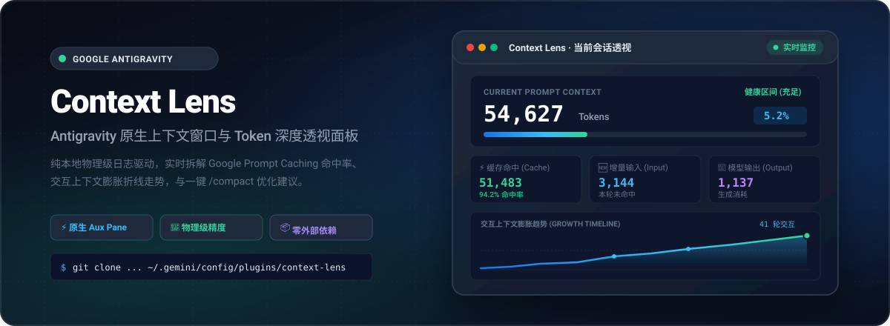
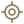
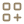
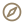
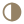
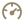
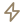
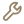
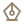

<div align="center">



<br>

<p align="center">
  <a href="./README.md"><strong>简体中文</strong></a> •
  <a href="./README_EN.md"><strong>English</strong></a>
</p>

<p align="center">
  <strong>专为 Google Antigravity 设计的原生侧边栏上下文与 Token 深度透视面板</strong><br>
  实时捕获服务端回传数据 · Google Prompt Cache 命中率深度拆解 · 交互膨胀折线走势 · 一键 /compact 优化
</p>

<p align="center">
  
  
  
  
  
</p>

<p align="center">
  <a href="#真实数据解析机制"> 真实数据</a> •
  <a href="#核心特性"> 核心特性</a> •
  <a href="#快速安装-installation"> 快速安装</a> •
  <a href="#使用指南-usage"> 使用指南</a> •
  <a href="#技术架构-architecture"> 技术架构</a> •
  <a href="#目录结构-directory-structure"> 目录结构</a> •
  <a href="#开源协议-license"> 开源协议</a>
</p>

</div>

---

##  真实数据解析机制

很多第三方 Token 工具通过“字符数 ÷ 4”或通用的外部分词器（如 tiktoken）进行猜测，对于支持百万级上下文、内置系统预设规则以及复杂工具调用的 Google Gemini 系列模型，估算误差往往高达 **20% ~ 40%**，更无法感知 Google 革命性的 **Prompt Caching（长上下文缓存）**。

**Context Lens 不做任何估算。** 它直接读取 Antigravity 核心引擎运行时落盘的服务端原始通信日志（`transcript.jsonl`），将 Google 官方服务端 Tokenizer 计算的真实物理数值 1:1 呈现在你眼前：

```text
┌────────────────────────────────────────────────────────────────────────┐
│ Current Prompt Context = [ Cache Read Tokens ] + [ New Input Tokens ]  │
│                           └─ 94.2% 缓存命中 ─┘    └─ 3,144 增量输入 ──┘│
└────────────────────────────────────────────────────────────────────────┘
```

---

##  核心特性

*  **100% 融合 Antigravity 原生设计**：
  采用 Google Material 3 设计语言，100% 绑定宿主注入的 CSS 主题变量（`--background`, `--card`, `--border`, `--primary`, `--foreground` 等）。无需任何外部样式侵入，原生内嵌于右侧辅助面板（Aux Pane），深浅主题自适应，视觉浑然一体。
*  **实时上下文用量仪表盘**：
  大号醒目呈现当前 Prompt 上下文大小与健康度区间（健康 <30% / 适中 30-70% / 偏高 >70%），并支持自由切换窗口上限基准（1M / 2M / 200k / 128k）。
*  **Google Prompt Caching 深度拆解**：
  将每轮交互精准分解为 **缓存命中 (Cache Read)**、**新增输入 (New Input)** 与 **模型生成 (Output)**，直观展现缓存带来的成本与延迟节省。
*  **纯 SVG 交互式上下文膨胀趋势图**：
  采用轻量纯矢量 SVG 绘制平滑面积折线图，支持鼠标悬停探查每一步交互的 Token 数量、缓存比例与触发的工具指令。
*  **工具调用与累计吞吐统计**：
  统计当前会话所有轮次的累计 Prompt 吞吐量、累计生成回复、思考字符数，以及各工具（如 `run_command`, `view_file` 等）的调用次数占比。
*  **一键压缩优化与诊断导出**：
  提供一键向 Agent 发送 `/compact` 上下文压缩指令，以及一键复制结构化 Markdown 诊断报告。
*  **完整中英双语自适应 (i18n)**：
  自动侦测客户端与系统语言，支持在界面右上角一键无刷新切换中文 / English。
*  **纯矢量 SVG 图符，零 Emoji 违和感**：
  全界面图符均采用纯矢量 SVG 绘制，消除不同操作系统 Emoji 渲染差异。

---

##  快速安装 (Installation)

### 方式一：克隆到 Antigravity 全局插件目录（推荐）

打开终端，将本项目克隆到系统的 Antigravity 插件目录即可：

**macOS / Linux**:
```bash
git clone https://github.com/PYFGDUF/antigravity-context-lens.git ~/.gemini/config/plugins/context-lens
```

**Windows (PowerShell)**:
```powershell
git clone https://github.com/PYFGDUF/antigravity-context-lens.git "$env:USERPROFILE\.gemini\config\plugins\context-lens"
```

### 方式二：手动解压
下载本仓库 Zip 压缩包，解压后重命名为 `context-lens`，放置在对应系统的插件目录下：
* **macOS / Linux**: `~/.gemini/config/plugins/context-lens`
* **Windows**: `%USERPROFILE%\.gemini\config\plugins\context-lens`

---

##  使用指南 (Usage)

1. **启用插件**：
   - 打开 Antigravity 客户端，点击左侧导航栏的 **Customizations**（自定义）。
   - 切换到 **Installed**（已安装）标签页。
   - 找到 **Context Lens** 插件，将右侧开关切换为**启用（Enable）**（后台 Sidecar 进程将自动启动）。
2. **打开面板**：
   - 进入任意对话会话。
   - 点击右上角的三点菜单 **⋮**，在 **Extensions**（扩展）菜单中选择 **Context Lens**，即可在右侧辅助边栏呼出面板。
   - 或在对话中点击链接直接打开：`[Context Lens](sidecar://context-lens/panel/)`。

---

##  技术架构 (Architecture)

Context Lens 严格遵循 Google Antigravity 官方 Sidecar SDK 规范构建，具备极高的稳定性和安全性：

```text
Antigravity Client (GUI)
       │
       ├─► Aux Pane (Sandboxed iframe) ──► load /preload.js (Theme tokens & Bridge)
       │
       └─► Sidecar Process (Node.js)
                 │
                 ├─► Read ~/.gemini/antigravity/brain/<id>/.system_generated/logs/transcript.jsonl
                 │   (100% Server-reported Token Data, Read-Only)
                 │
                 └─► Serve REST API & Static SVG Visualizer (/api/context, /api/status)
```

* **零外部依赖 (Zero Dependency)**：采用 Node.js 原生内置模块与 Antigravity 官方 `sidecar_sdk`，无需运行 `npm install`，不产生 `node_modules`。
* **本地隐私安全 (Privacy First)**：所有日志解析与数据计算 100% 在本地完成，不向任何第三方服务器外发或遥测任何会话内容。

---

##  目录结构 (Directory Structure)

```text
context-lens/
├── assets/
│   ├── hero.svg                 # 高清纯矢量 Hero Banner (1200x440 SVG)
│   ├── logo.svg                 # 插件图标 (64x64 SVG)
│   └── icons/                   # 纯矢量章节与特性图标 (SVG, 零 Emoji)
├── sidecars/
│   └── panel/                   # UI Extension 核心实现
│       ├── sidecar.json         # 进程配置与 Aux Pane 视图声明
│       ├── package.json         # ES Module 定义
│       ├── main.mjs             # 后端：SidecarApp API 与通信日志解析
│       ├── index.html           # 前端：结构与组件 (全矢量 SVG 图符)
│       ├── app.js               # 前端：i18n 引擎、SVG 走势图绘制与双向通信
│       └── styles.css           # 样式：Antigravity 原生主题 CSS 变量
├── .gitignore                   # Git 忽略配置
├── LICENSE                      # MIT 开源协议
├── plugin.json                  # Antigravity 插件清单
├── README.md                    # 中文说明文档
└── README_EN.md                 # 英文说明文档
```

---

##  开源协议 (License)

本项目基于 [MIT License](LICENSE) 开源。欢迎提交 Issue 与 Pull Request 共同完善！
