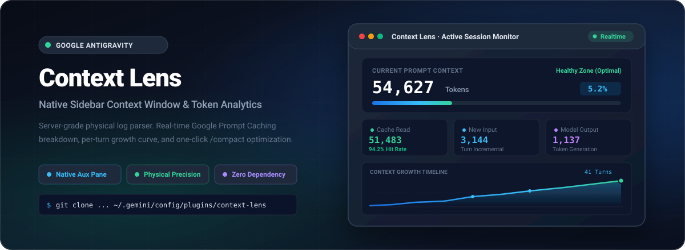

<div align="center">



<br>

<p align="center">
  <a href="./README.md"><strong>简体中文</strong></a> •
  <a href="./README_EN.md"><strong>English</strong></a>
</p>

<p align="center">
  <strong>Native Sidebar Context Window & Token Analytics Extension for Google Antigravity</strong><br>
  Real-time server-reported data · Google Prompt Caching breakdown · Step-by-step growth curves · One-click /compact optimization
</p>

<p align="center">
  
  
  
  
  
</p>

<p align="center">
  <a href="#physical-server-grade-precision"> Accuracy</a> •
  <a href="#key-features"> Features</a> •
  <a href="#installation"> Installation</a> •
  <a href="#usage-guide"> Usage</a> •
  <a href="#architecture"> Architecture</a> •
  <a href="#directory-structure"> Directory</a> •
  <a href="#license"> License</a>
</p>

</div>

---

##  Physical Server-Grade Precision

Many third-party token tools estimate context size by calculating "character count ÷ 4" or using generic external tokenizers (like tiktoken). For Google Gemini models handling million-token windows, system instruction prefixes, and structured tool calls, these heuristics suffer from **20% to 40% error margins** and completely fail to measure Google's revolutionary **Prompt Caching**.

**Context Lens makes zero guesses.** It directly streams and parses Antigravity's runtime logs (`transcript.jsonl`), exposing the exact physical values generated by Google's official server-side tokenizer:

```text
┌────────────────────────────────────────────────────────────────────────┐
│ Current Prompt Context = [ Cache Read Tokens ] + [ New Input Tokens ]  │
│                           └─ 94.2% Cache Hit ─┘   └─ 3,144 New Inputs ─┘│
└────────────────────────────────────────────────────────────────────────┘
```

---

##  Key Features

*  **100% Native Antigravity Design Integration**:
  Built on Google Material 3 design principles, fully bound to host-injected CSS theme variables (`--background`, `--card`, `--border`, `--primary`, `--foreground`). Integrates seamlessly into the Aux Pane without layout shifting.
*  **Real-Time Context Gauge**:
  High-visibility gauges displaying current prompt context consumption and health zones (Healthy <30% / Moderate 30-70% / High >70%), with selectable context limits (1M / 2M / 200k / 128k).
*  **In-Depth Prompt Cache Decomposition**:
  Accurately dissects every interaction step into **Cache Read**, **New Input**, and **Output Generation**, providing clear visibility into token cost and latency reduction.
*  **Pure SVG Interactive Growth Curve**:
  Lightweight vector-rendered area charts with interactive hover probes detailing per-turn tokens, cache hit rates, and triggered tools.
*  **Cumulative Throughput & Tool Breakdown**:
  Tracks conversation-level cumulative throughput, generated responses, thinking characters, and tool invocation distribution (e.g., `run_command`, `view_file`).
*  **One-Click Compaction & Diagnostic Export**:
  Send `/compact` instructions to the active agent with a single click, or copy structured Markdown diagnostic reports to your clipboard.
*  **Bilingual i18n Engine**:
  Auto-detects client environment and supports instant toggle between English and Simplified Chinese without page reload.
*  **Pure Vector SVG Glyphs (Zero Emojis)**:
  Clean, crisp vector icons throughout both UI and documentation, avoiding cross-platform emoji rendering inconsistencies.

---

##  Installation

### Method 1: Clone into Global Plugins Directory (Recommended)

Clone this repository directly into Antigravity's global plugin path:

**macOS / Linux**:
```bash
git clone https://github.com/PYFGDUF/antigravity-context-lens.git ~/.gemini/config/plugins/context-lens
```

**Windows (PowerShell)**:
```powershell
git clone https://github.com/PYFGDUF/antigravity-context-lens.git "$env:USERPROFILE\.gemini\config\plugins\context-lens"
```

### Method 2: Manual Download
Download the repository as a ZIP archive, unpack and rename the directory to `context-lens`, and place it in:
* **macOS / Linux**: `~/.gemini/config/plugins/context-lens`
* **Windows**: `%USERPROFILE%\.gemini\config\plugins\context-lens`

---

##  Usage Guide

1. **Enable Plugin**:
   - In Antigravity, navigate to **Customizations** in the left sidebar.
   - Switch to the **Installed** tab.
   - Locate **Context Lens** and toggle it to **Enabled** (the background sidecar process will start automatically).
2. **Open Extension Panel**:
   - Open any active chat conversation.
   - Click the **⋮** menu in the top-right corner, select **Extensions** > **Context Lens** to dock it into the Aux Pane.
   - Or click this link directly in chat: `[Context Lens](sidecar://context-lens/panel/)`.

---

##  Architecture

Context Lens is built strictly in accordance with Google Antigravity Sidecar SDK standards:

```text
Antigravity Client (GUI)
       │
       ├─► Aux Pane (Sandboxed iframe) ──► load /preload.js (Theme tokens & Bridge)
       │
       └─► Sidecar Process (Node.js)
                 │
                 ├─► Read ~/.gemini/antigravity/brain/<id>/.system_generated/logs/transcript.jsonl
                 │   (100% Server-reported Token Data, Read-Only)
                 │
                 └─► Serve REST API & Static SVG Visualizer (/api/context, /api/status)
```

* **Zero External Dependencies**: Powered purely by Node.js built-ins and Antigravity's `sidecar_sdk`. No `npm install`, zero `node_modules` clutter.
* **Privacy-First & Local**: All log analysis and aggregation run 100% locally on your machine. No telemetry or conversation content leaves your system.

---

##  Directory Structure

```text
context-lens/
├── assets/
│   ├── hero.svg                 # Hi-res pure vector Chinese Hero Banner (1200x440 SVG)
│   ├── hero_en.svg              # Hi-res pure vector English Hero Banner (1200x440 SVG)
│   ├── logo.svg                 # Plugin icon (64x64 SVG)
│   └── icons/                   # Vector section & feature icons (SVG, Zero Emoji)
├── sidecars/
│   └── panel/                   # UI Extension implementation
│       ├── sidecar.json         # Process config & Aux Pane entry declaration
│       ├── package.json         # ES Module definition
│       ├── main.mjs             # Backend: SidecarApp API & log stream parsing
│       ├── index.html           # Frontend: Layout & components (Pure SVG glyphs)
│       ├── app.js               # Frontend: i18n engine, SVG chart rendering & RPC
│       └── styles.css           # Styling: Antigravity Material 3 CSS variables
├── .gitignore                   # Git ignore rules
├── LICENSE                      # MIT License
├── plugin.json                  # Antigravity plugin manifest
├── README.md                    # Chinese documentation
└── README_EN.md                 # English documentation
```

---

##  License

This project is licensed under the [MIT License](LICENSE). Contributions, issues, and pull requests are welcome!
